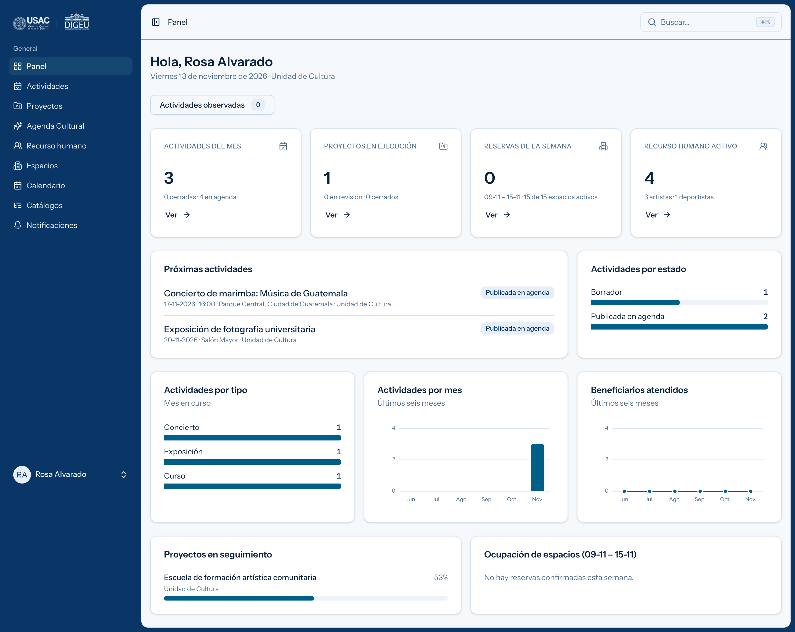

# SIGEU — Sistema Interno de Gestión de la Extensión Universitaria

Sistema web de la **Dirección General de Extensión Universitaria (DIGEU)** de la
Universidad de San Carlos de Guatemala. Reúne en un solo lugar la programación de
actividades, la gestión de proyectos, el uso de los espacios y el padrón de
artistas y deportistas, y publica hacia afuera la Agenda Cultural y el catálogo
de espacios.



---

## Qué resuelve

| Módulo             | Qué hace                                                                                                                       |
| ------------------ | ------------------------------------------------------------------------------------------------------------------------------ |
| **Actividades**    | Programación mensual, circuito de validación, ejecución, cierre con beneficiarios e indicadores, reportes mensual y acumulado. |
| **Proyectos**      | Formulación, aprobación, avances, vinculación de actividades, informe y cierre.                                                |
| **Espacios**       | Sedes y espacios, calendario de ocupación, solicitudes de uso internas y externas.                                             |
| **Recurso humano** | Padrón de artistas y deportistas, permanencia, bajas y reactivaciones, reportes.                                               |
| **Transversal**    | Usuarios y roles, catálogos administrables, notificaciones, bitácora, buscador global, impresión con membrete.                 |
| **Público**        | Agenda Cultural con página por actividad, catálogo de espacios y formulario de solicitud, sin necesidad de cuenta.             |

La especificación completa está en
[doc/REQUERIMIENTOS_SIGEU_DIGEU.md](doc/REQUERIMIENTOS_SIGEU_DIGEU.md) y el
recorrido por rol en [doc/MANUAL_DE_USUARIO.md](doc/MANUAL_DE_USUARIO.md).

---

## Stack

- **PHP 8.3+** y **Laravel 13**
- **Inertia v3** con **React 19** y **TypeScript**
- **Tailwind CSS v4** y componentes shadcn/ui sobre Radix
- **Laravel Fortify** para autenticación (incluye segundo factor y claves de acceso)
- **Laravel Wayfinder** para tipar las rutas en el frontend
- **Vite** para el empaquetado
- **Pest 5**, **Pint** y **Larastan** (nivel 7) para la calidad del código

El proyecto **no usa paquetes de terceros para hojas de cálculo ni para
gráficas**: los archivos `.xlsx` se escriben y se leen con `ZipArchive`
(`app/Actions/HojasDeCalculo`) y las gráficas del tablero son SVG propio
(`resources/js/components/graficas`).

---

## Puesta en marcha

Requisitos: PHP 8.3 o superior con las extensiones `zip`, `gd` y `sqlite3`,
Composer 2 y Node 20 o superior.

```bash
composer setup
```

Ese comando instala dependencias, crea el `.env`, genera la llave de la
aplicación, corre las migraciones y compila el frontend. Después, para cargar
los catálogos oficiales y el usuario administrador:

```bash
php artisan db:seed
```

Y para levantar el entorno de desarrollo (servidor, cola, logs y Vite en una
sola terminal):

```bash
composer dev
```

La aplicación queda en <http://localhost:8000>.

### Datos de demostración

Para recorrer el sistema con información ya cargada —unidades, un usuario por
rol, actividades en distintos estados, un proyecto en ejecución y el padrón—:

```bash
php artisan db:seed --class=DemoSeeder
```

Todos los usuarios de demostración usan la contraseña `password`:

| Correo                  | Rol                                  |
| ----------------------- | ------------------------------------ |
| `admin@digeu.test`      | Administrador                        |
| `direccion@digeu.test`  | Dirección                            |
| `validacion@digeu.test` | Validador                            |
| `cultura@digeu.test`    | Coordinador de la Unidad de Cultura  |
| `deportes@digeu.test`   | Coordinador de la Unidad de Deportes |
| `espacios@digeu.test`   | Administrador de espacios            |
| `padron@digeu.test`     | Gestor de recurso humano             |
| `consulta@digeu.test`   | Consulta                             |

> Son datos de prueba. No deben sembrarse en producción.

---

## Comandos de uso diario

```bash
composer dev
```

```bash
php artisan test --compact
```

```bash
composer ci:check
```

`ci:check` corre el formateo del frontend, la verificación de tipos de
TypeScript, Pint, Larastan y toda la suite de pruebas. Es lo que debe pasar antes
de dar por terminado un cambio.

Si se tocan controladores o rutas, hay que regenerar las funciones tipadas que
consume el frontend:

```bash
php artisan wayfinder:generate --with-form
```

---

## Estructura

```
app/
  Actions/           Casos de uso por módulo (Actividades, Proyectos, Espacios,
                     RecursoHumano) y HojasDeCalculo para la carga masiva
  Enums/             Roles, estados y catálogos tipados
  Http/Controllers/  Un controlador por caso de uso, agrupados por módulo
  Models/            Eloquent con sus scopes y relaciones
  Policies/          Permisos por rol y por unidad
  Notifications/     Avisos del circuito de revisión y de las reservas
database/
  migrations/        Esquema
  seeders/           Catálogos oficiales, datos de demostración
doc/                 Requerimientos, manual de usuario y capturas
resources/
  js/pages/          Pantallas (Inertia + React), una por ruta
  js/components/     Componentes compartidos, incluidas las gráficas
  css/app.css        Tema, identidad institucional y hoja de impresión
routes/              web, settings, y un archivo por módulo
tests/Feature/       La mayor parte de la cobertura, por módulo
```

---

## Calidad

La suite cubre los circuitos completos de cada módulo —no solo los controladores—
y los límites de permisos de cada rol: 229 pruebas y 1 333 aserciones.

```bash
php artisan test --compact
```

Larastan corre en nivel 7 sin errores y Pint aplica el estilo del proyecto.

---

## Seguridad y privacidad

- Los permisos se resuelven en el servidor con _policies_; el frontend solo
  oculta lo que el servidor ya niega.
- El DPI y el pasaporte del padrón solo son visibles para el Gestor de recurso
  humano y para Dirección, y **nunca** se usan como criterio en el buscador
  global.
- Toda acción sobre actividades, proyectos, espacios, padrón y usuarios queda
  registrada en la bitácora con autor, fecha y valores anteriores.

---

## Despliegue en hosting compartido

En un servidor sin Composer ni Node —Hostinger, por ejemplo— el proyecto se
sube por git con `vendor` y `public/build` ya versionados. Por eso el
`.gitignore` los deja pasar y en cambio excluye `node_modules`, que solo hace
falta para compilar.

Antes de confirmar el despliegue conviene dejar `vendor` sin las herramientas
de desarrollo:

```bash
composer install --no-dev --optimize-autoloader
```

Pasa de 173 MB a 53 MB. Para volver a trabajar en local, `composer install`
las devuelve.

En el servidor:

1. La raíz del dominio debe apuntar a `public/`, no a la carpeta del proyecto.
2. Cree el `.env` con `APP_ENV=production`, `APP_DEBUG=false`, la `APP_KEY` y
   las credenciales de la base de datos.
3. Importe desde phpMyAdmin
   [`doc/despliegue/sigeu-esquema-y-catalogos.sql`](doc/despliegue/sigeu-esquema-y-catalogos.sql)
   —esquema completo y catálogos oficiales— y después
   [`doc/despliegue/sigeu-administrador.sql`](doc/despliegue/sigeu-administrador.sql),
   que crea la primera cuenta. Las instrucciones están dentro de cada archivo.
4. Dé permiso de escritura a `storage/` y `bootstrap/cache/`.

`public/storage` viaja como enlace relativo, así que las fotografías de los
espacios funcionan sin ejecutar `php artisan storage:link`. `public/hot` nunca
debe llegar al servidor: con ese archivo presente la aplicación busca los
recursos en el Vite de desarrollo y la página sale en blanco.

---

## Pendientes de la entrega

- **Exportación a PDF y a Excel con biblioteca** (RF-1.11, RF-2.09, RF-T.09).
  Hoy los reportes se imprimen con membrete desde el navegador, que también
  permite guardarlos en PDF; la exportación nativa está sujeta a la aprobación
  de dependencias.
- **Listados oficiales** de unidades, disciplinas, agrupaciones y sedes, por
  confirmar con la DIGEU (sección 15 de los requerimientos).
- **Motor de base de datos de producción**, por definir con la DIGEU. El
  esquema es portable: `.env.example` trae SQLite para arrancar sin instalar
  nada y el entorno de desarrollo actual corre sobre MySQL sin cambios de
  código.
