# SIGEU · Manual de usuario

Sistema Interno de Gestión de la Extensión Universitaria
Dirección General de Extensión Universitaria — Universidad de San Carlos de Guatemala

Este manual explica cómo usar el sistema **según el rol que tenga asignado**.
Busque su rol en el índice y lea esa sección; las secciones «Para todos» y
«El sitio público» aplican a cualquier persona.

---

## Índice

1. [Entrar al sistema](#1-entrar-al-sistema)
2. [Para todos: lo que verá en cualquier pantalla](#2-para-todos-lo-que-verá-en-cualquier-pantalla)
3. [Coordinador de unidad](#3-coordinador-de-unidad)
4. [Validador](#4-validador)
5. [Dirección](#5-dirección)
6. [Administrador de espacios](#6-administrador-de-espacios)
7. [Gestor de recurso humano](#7-gestor-de-recurso-humano)
8. [Consulta](#8-consulta)
9. [Administrador](#9-administrador)
10. [El sitio público](#10-el-sitio-público)
11. [Anexos](#11-anexos)

---

## 1. Entrar al sistema

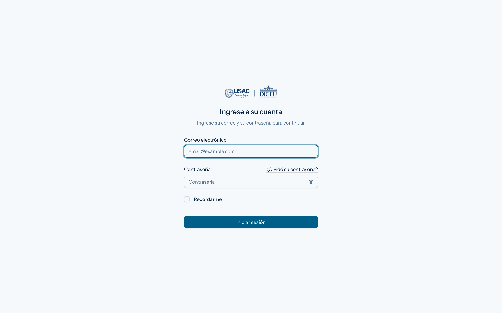

Escriba su correo institucional y su contraseña. Si olvidó la contraseña, use
**¿Olvidó su contraseña?**: el sistema envía un enlace de recuperación al correo
registrado.

**Si es su primer ingreso**, el Administrador le habrá creado la cuenta con una
contraseña temporal. Cámbiela de inmediato: pulse **su nombre, abajo a la
izquierda** y entre a **Seguridad**.

En ese mismo menú están **Perfil**, para corregir su nombre o su correo, y
**Apariencia**, para elegir el tema claro, el oscuro o el del sistema.

> **Su sesión se cierra sola** tras un período de inactividad. Si estaba llenando
> un formulario largo, guarde seguido.

---

## 2. Para todos: lo que verá en cualquier pantalla

### El panel

Es lo primero que aparece al entrar. Muestra los números del mes, lo que viene
en los próximos días y lo que está pendiente de su parte.

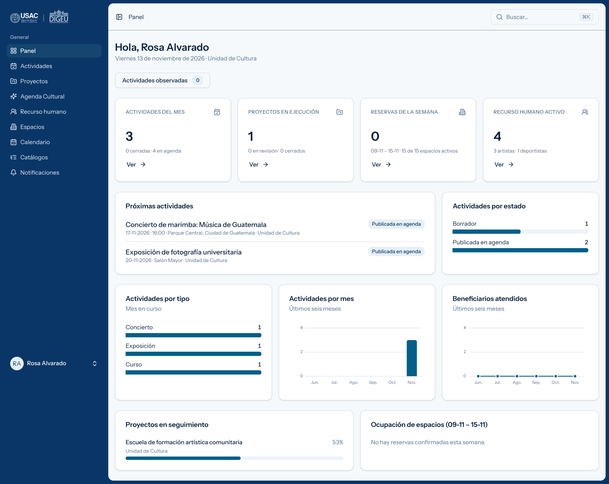

Las tarjetas de arriba son enlaces: pulse **Ver** para ir al listado completo.
Las gráficas de abajo resumen las actividades del período; pase el puntero por
encima de una barra o una columna para ver el dato exacto.

> Lo que muestra el panel **depende de su rol**: un coordinador ve su unidad;
> Dirección, Validador y Administrador ven toda la DIGEU.

### El buscador

Pulse **⌘K** (en Mac) o **Ctrl+K** (en Windows), o el cuadro **Buscar…** del
encabezado. Escriba al menos dos letras.

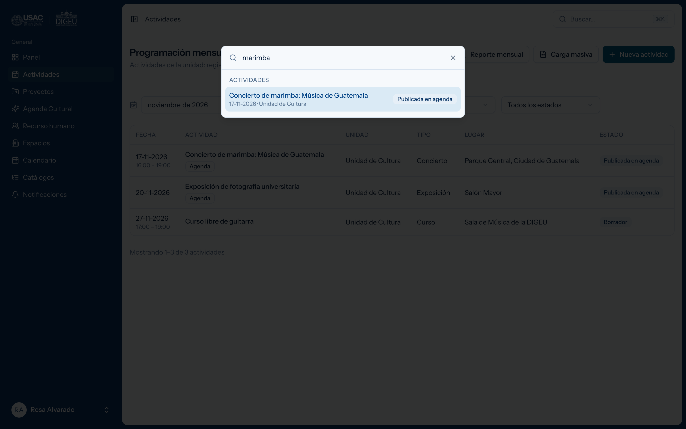

Busca a la vez en actividades, proyectos, padrón, espacios y usuarios, y agrupa
los resultados. Muévase con las flechas ↑ ↓ y abra con **Enter**.

Solo aparece lo que usted tiene permiso de ver. En el padrón, la búsqueda es
**únicamente por nombre y apellido**: el DPI y el pasaporte nunca se usan como
criterio ni se muestran en los resultados.

### Las notificaciones

El sistema le avisa cuando algo requiere su atención: una actividad que le
observaron, un proyecto que le aprobaron, una solicitud de espacio nueva.
Entre por **Notificaciones** en el menú. Desde ahí puede marcarlas como leídas,
una por una o todas de golpe.

### Imprimir

Los reportes traen el botón **Imprimir**. La hoja sale con el membrete
institucional —USAC, DIGEU, el título del reporte, el período, la unidad y la
fecha de impresión— y sin la navegación del sistema.

Desde el cuadro de impresión del navegador puede elegir **Guardar como PDF** en
lugar de una impresora.

### Catálogos

**Catálogos** en el menú muestra las listas que alimentan los formularios: tipos
de actividad, líneas de acción, disciplinas, sedes, indicadores y demás.
Cualquier usuario puede consultarlas; solo el Administrador puede modificarlas.

---

## 3. Coordinador de unidad

Usted registra y lleva las actividades y los proyectos **de su unidad**. No ve ni
modifica los de otras unidades.

### 3.1 Programar una actividad

**Actividades → Nueva actividad.**

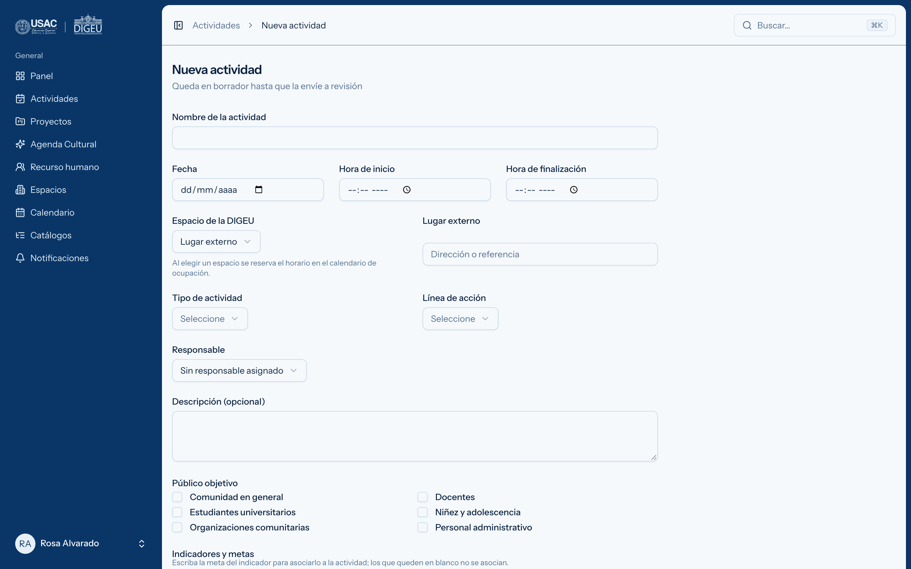

Llene el formulario y guarde. Tenga presente:

- **Toda actividad necesita un lugar.** O elige un espacio del catálogo de la
  DIGEU, o escribe el lugar externo. No las dos cosas.
- **Si elige un espacio**, la hora de inicio y la de finalización son
  obligatorias, porque el sistema levanta automáticamente una **reserva** que el
  Administrador de espacios debe aprobar.
- **Público objetivo e indicadores** se agregan en la ficha de la actividad,
  después de guardarla.

La actividad queda en **Borrador**: solo usted la ve, y puede editarla o
eliminarla cuantas veces quiera.

### 3.2 Cargar muchas actividades de una vez

Si ya tiene la programación del mes o del semestre en una hoja, no la escriba
una por una.

**Actividades → Carga masiva.**

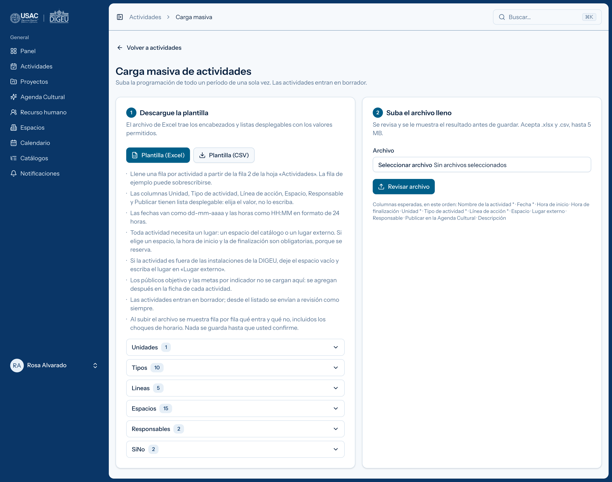

**Paso 1.** Descargue **Plantilla (Excel)**. El archivo trae los encabezados en
el orden correcto, una fila de ejemplo que puede sobrescribir y **listas
desplegables** en las columnas de catálogo (Unidad, Tipo, Línea de acción,
Espacio, Responsable y Publicar): elija el valor de la lista, no lo escriba a
mano. Hay también una **Plantilla (CSV)** si prefiere trabajar en otro programa.

**Paso 2.** Suba el archivo lleno y pulse **Revisar archivo**.

**Paso 3.** El sistema le muestra, fila por fila, qué entra y qué no.

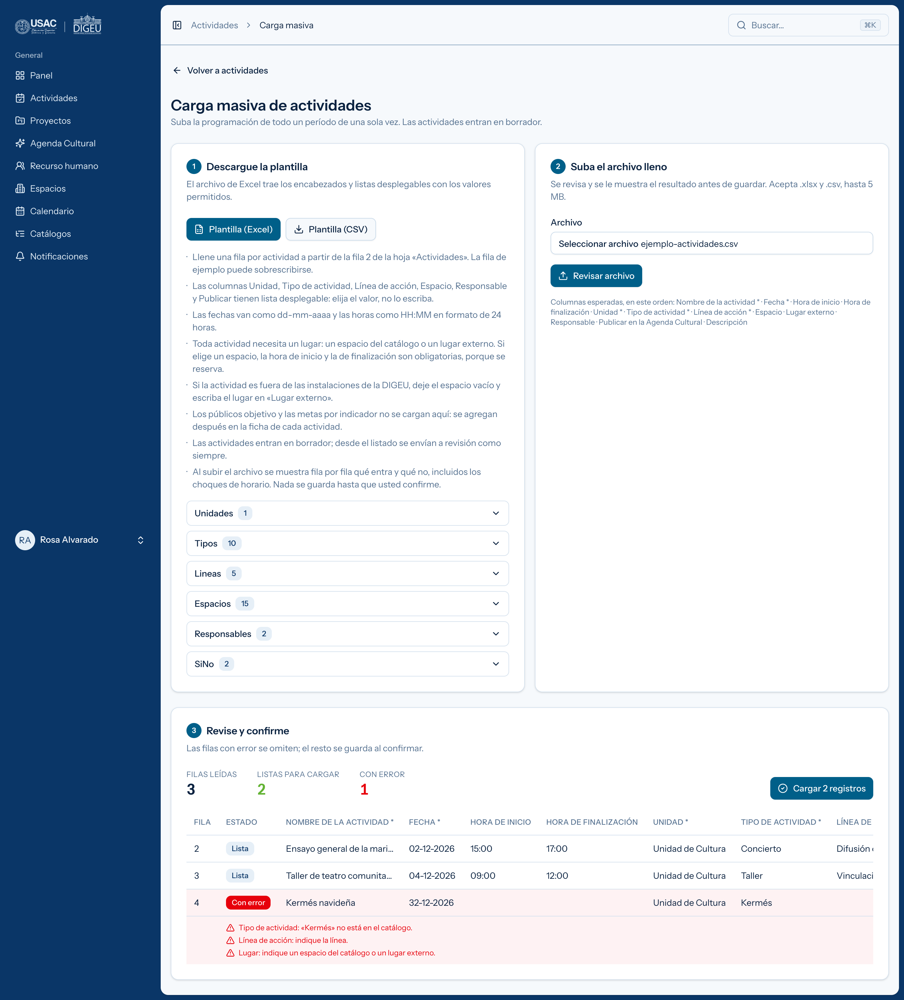

Las filas con error aparecen marcadas y debajo se explica qué está mal, en
palabras: _«Kermés» no está en el catálogo_, _indique un espacio del catálogo o
un lugar externo_, _choca con una reserva aprobada_. **Nada se guarda todavía.**

Corrija el archivo y vuelva a subirlo, o pulse **Cargar N registros** para
guardar las filas correctas y dejar las demás fuera.

Las actividades cargadas entran en **Borrador** y siguen el circuito normal:
desde el listado las envía a revisión como siempre.

> La revisión avisa de los choques de horario tanto contra lo ya reservado como
> **entre dos filas del mismo archivo**.

### 3.3 Enviar a revisión

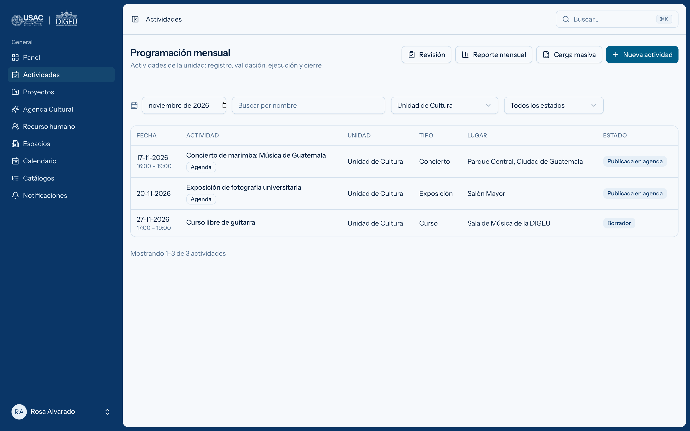

El listado de **Actividades** es su pantalla de trabajo: filtra por mes, nombre y
estado, y desde ahí se entra a cada ficha.

Desde el listado o desde la ficha, pulse **Enviar a revisión**. La actividad pasa
a **Enviada** y ya no puede editarla mientras esté en manos del Validador.

Si se la **observan**, recibirá una notificación con el comentario; la actividad
vuelve a quedar editable. Corrija y envíela de nuevo.

### 3.4 Llevar la ejecución

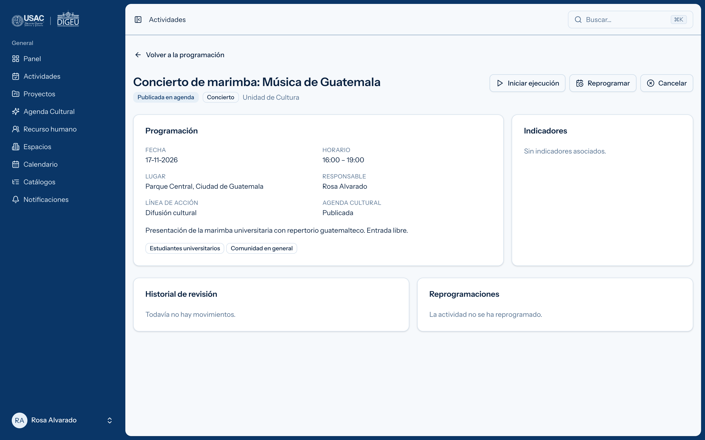

Una vez **Validada**, la ficha ofrece:

| Acción          | Cuándo se usa                                                    |
| --------------- | ---------------------------------------------------------------- |
| **Iniciar**     | El día de la actividad, para marcarla en ejecución.              |
| **Reprogramar** | Cambió la fecha. Queda registrado el motivo y la fecha anterior. |
| **Cancelar**    | Ya no se hará. Pide el motivo.                                   |
| **Cierre**      | Terminó. Es donde se registra el resultado.                      |

### 3.5 Cerrar la actividad

**Cierre** es la pantalla más importante del módulo: ahí se registra lo que
después alimenta todos los reportes.

- **Beneficiarios**, desagregados por sexo y por rango de edad.
- **Avance de cada indicador** comprometido.
- **Evidencias**: fotografías, listados de asistencia, enlaces.
- **Observaciones** de lo ocurrido.

Al guardar, la actividad pasa a **Cerrada** y ya no se modifica.

### 3.6 Reportes

**Actividades → Reporte mensual** y **Reporte acumulado**.

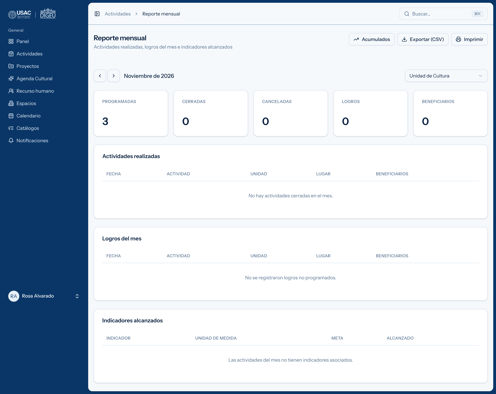

Elija el período y, si tiene alcance para más de una unidad, la unidad. Use
**Imprimir** para la versión con membrete, o **Exportar (CSV)** para llevar los
datos a una hoja de cálculo.

### 3.7 Proyectos

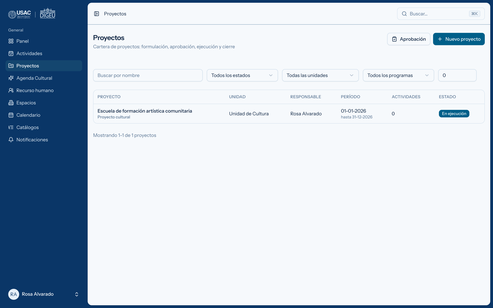

El circuito es parecido al de las actividades, con un paso más de formulación:

1. **Nuevo proyecto** — datos generales. Queda **Registrado**.
2. **Formulación** — objetivos, metas por indicador, presupuesto, recursos y
   fuentes de financiamiento.
3. **Enviar a aprobación** — pasa a **En revisión**.
4. Dirección o el Validador lo **aprueban**, lo **observan** o lo **rechazan**.
5. **Iniciar** — pasa a **En ejecución**.
6. **Avances** — se registran periódicamente, con el porcentaje y lo ejecutado
   del presupuesto.
7. **Cierre** — informe final, beneficiarios e indicadores alcanzados.

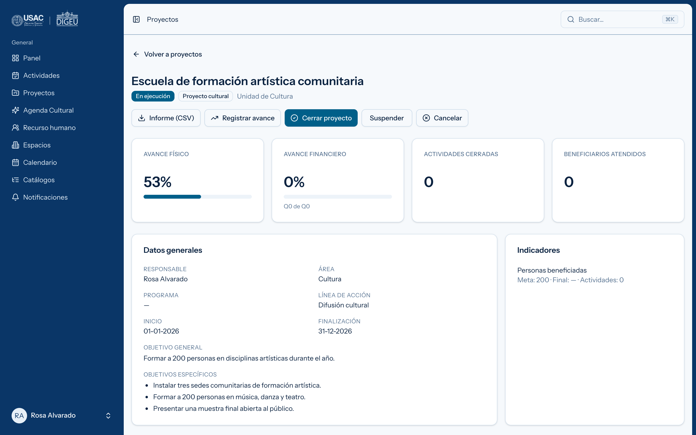

Desde la ficha del proyecto puede **vincular actividades** ya registradas: así
los resultados de esas actividades suman al avance del proyecto y aparecen en su
informe.

---

## 4. Validador

Usted revisa lo que envían las unidades. Ve **todas las unidades** de la DIGEU.

### 4.1 La bandeja de revisión

**Actividades → Revisión.**

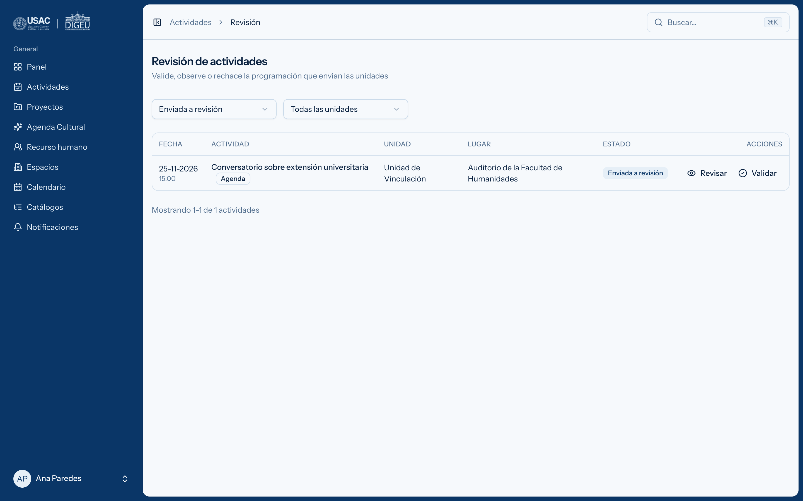

Ahí están las actividades en estado **Enviada**, esperando su decisión.

### 4.2 Decidir

Abra la actividad y revise los datos. Tiene tres salidas:

| Decisión     | Qué pasa                                                                                                             |
| ------------ | -------------------------------------------------------------------------------------------------------------------- |
| **Validar**  | La actividad queda aprobada y lista para ejecutarse.                                                                 |
| **Observar** | Vuelve a la unidad para corregir. **Escriba qué hay que corregir**: ese texto es lo único que recibe el coordinador. |
| **Rechazar** | Se descarta. Pide el motivo y no tiene vuelta atrás.                                                                 |

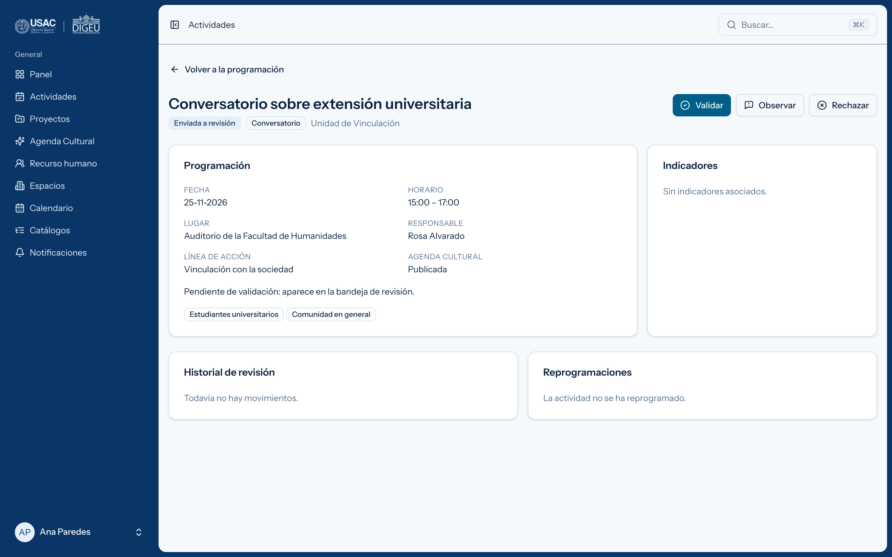

### 4.3 Publicar en la Agenda Cultural

Una vez validada la actividad, en la misma ficha aparece **Publicar en agenda**.
Eso la hace visible al público: entra en la Agenda Cultural del sitio, recibe su
propia página y puede compartirse en redes.

**Quítela de la agenda** con el botón correspondiente si se suspende o cambia.

> Publicar es decisión suya, no de la unidad. Revise que el nombre, la fecha, el
> lugar y la descripción estén presentables antes de publicar: ese texto es el
> que verá el público.

### 4.4 Proyectos

También puede **aprobar, observar o rechazar** proyectos desde
**Proyectos → Aprobación**, con el mismo criterio.

---

## 5. Dirección

Usted ve **toda la DIGEU** sin restricción de unidad, y aprueba proyectos.

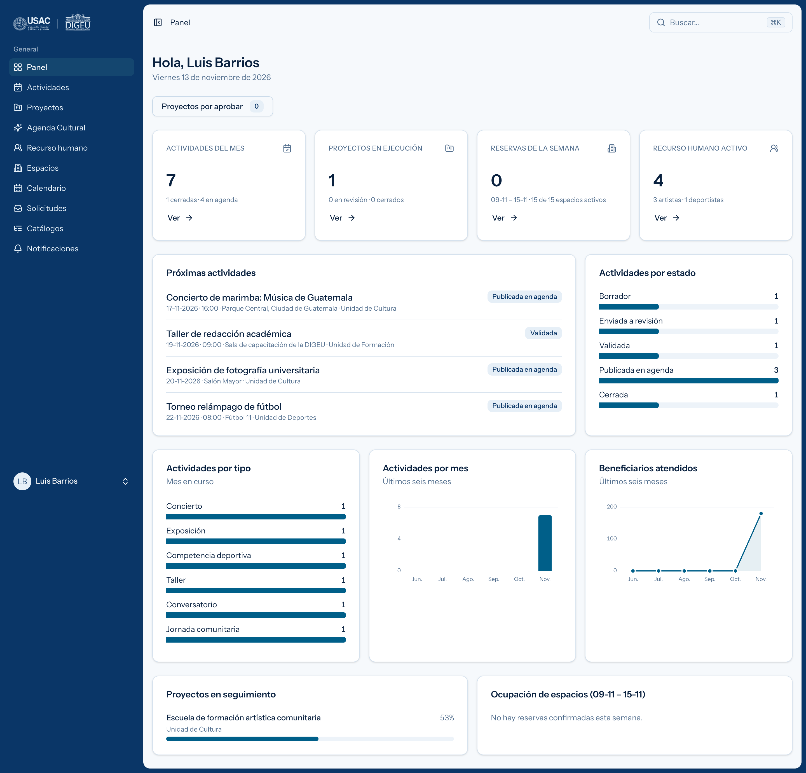

Lo que hace Dirección:

- **Consultar** actividades, proyectos, espacios y padrón de cualquier unidad,
  incluidos los datos sensibles del padrón (DPI y pasaporte).
- **Aprobar, observar o rechazar proyectos** en **Proyectos → Aprobación**.
- **Consultar las solicitudes** de uso de espacios, sin resolverlas.
- **Consultar todos los reportes**, incluidos el acumulado institucional y el
  de ocupación de espacios, e imprimirlos con membrete.

---

## 6. Administrador de espacios

Usted administra las sedes, los espacios y quién los usa.

### 6.1 Espacios

**Espacios** en el menú.

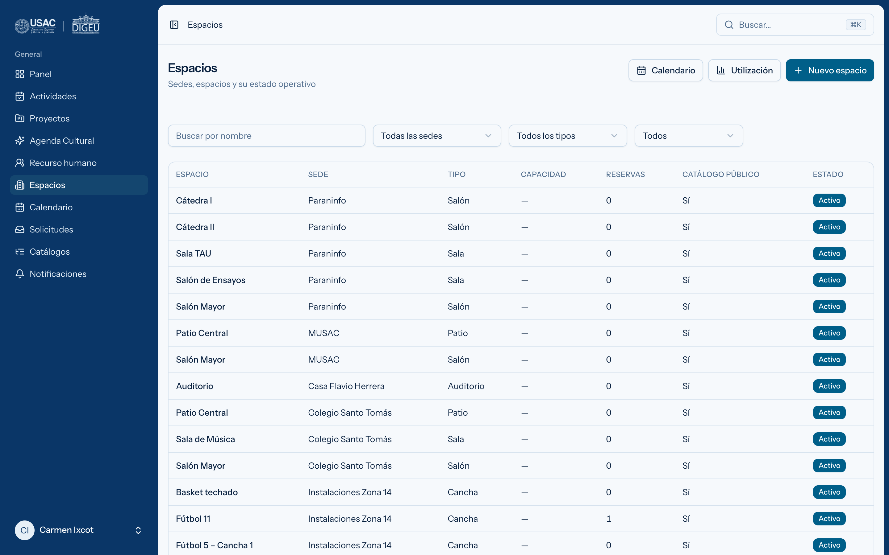

Cada espacio lleva su sede, tipo, capacidad, equipamiento, fotografías y
**estado**:

| Estado            | Qué implica                                         |
| ----------------- | --------------------------------------------------- |
| **Activo**        | Se puede reservar y aparece en el catálogo público. |
| **Mantenimiento** | No admite reservas nuevas.                          |
| **Inactivo**      | No se reserva ni aparece en el catálogo.            |

Las fotografías que cargue son las que ve el público en el catálogo: suba
imágenes que representen bien el espacio.

### 6.2 El calendario de ocupación

**Calendario** en el menú.

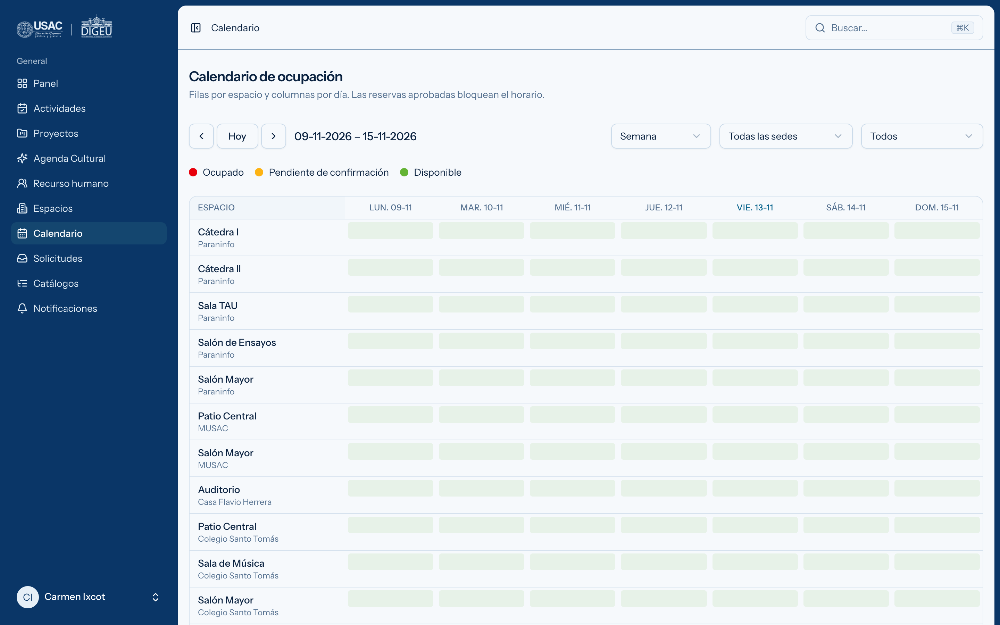

Muestra qué está ocupado y cuándo. Úselo antes de aprobar una solicitud para ver
el panorama de la semana.

### 6.3 Resolver solicitudes

**Solicitudes** en el menú. Llegan de dos lados:

- **Internas**: cuando un coordinador programa una actividad en un espacio de la
  DIGEU, el sistema crea la reserva automáticamente.
- **Externas**: desde el formulario público del sitio.

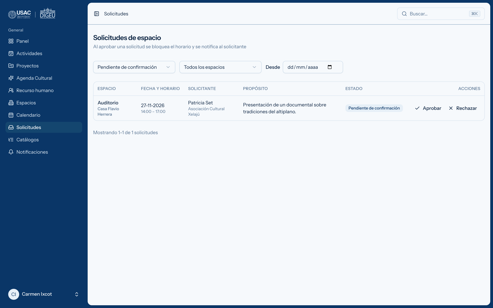

Revise que no haya choque de horario —el sistema se lo advierte— y resuelva:

| Acción       | Efecto                                                      |
| ------------ | ----------------------------------------------------------- |
| **Aprobar**  | El espacio queda reservado y bloqueado para ese horario.    |
| **Rechazar** | Se notifica al solicitante. Escriba el motivo.              |
| **Cancelar** | Para una reserva ya aprobada que se cae. Libera el horario. |

> Un espacio solo queda bloqueado cuando la solicitud está **aprobada**. Mientras
> esté pendiente, otra actividad puede pedir el mismo horario.

### 6.4 Reporte de uso

**Espacios → Reportes** da la ocupación por espacio y por período, con botón de
impresión con membrete.

---

## 7. Gestor de recurso humano

Usted lleva el padrón de artistas y deportistas de la DIGEU.

### 7.1 El padrón

**Recurso humano** en el menú.

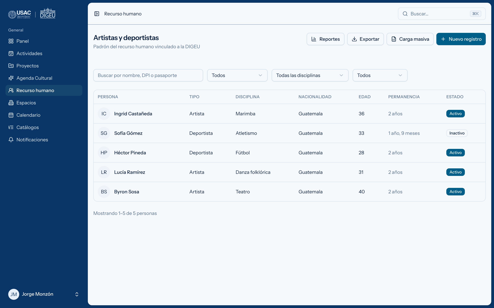

Cada persona se registra como **artista** o **deportista**, con su disciplina, su
agrupación, su país y su documento de identificación.

- Para personas **guatemaltecas** el **DPI es obligatorio**.
- Para personas **extranjeras** se registra el **pasaporte**.
- La **disciplina debe corresponder al tipo**: una disciplina artística no se
  asigna a un deportista.

> **DPI y pasaporte son datos sensibles.** Solo usted y Dirección los ven. No
> aparecen en el buscador global ni en las exportaciones generales.

### 7.2 Altas, bajas y reactivaciones

Al registrar a una persona se abre su **período de permanencia**. Si deja la
DIGEU, use **Dar de baja** e indique la fecha y el motivo: el período se cierra
pero el historial se conserva.

Si regresa, **Reactivar** abre un período nuevo sin borrar el anterior. Así el
padrón refleja la trayectoria completa de cada persona.

### 7.3 Cargar el padrón desde un archivo

**Recurso humano → Carga masiva.**

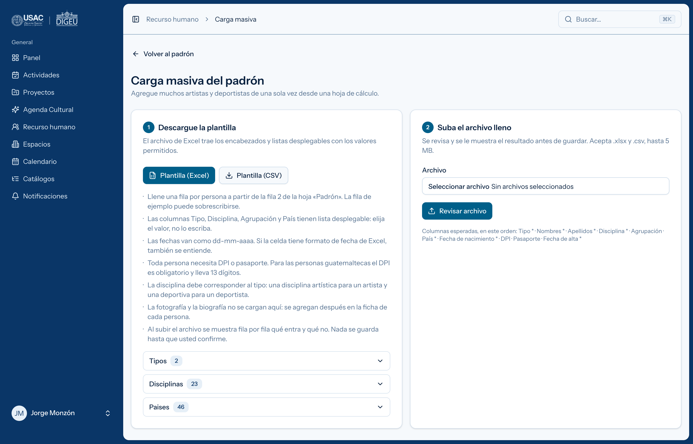

Funciona igual que la de actividades: descargue la plantilla, llénela, súbala y
**revise antes de confirmar**. La revisión avisa de los documentos repetidos
—tanto contra el padrón existente como entre dos filas del mismo archivo— y de
las disciplinas que no corresponden al tipo de persona.

### 7.4 Reportes

**Recurso humano → Reportes** da el padrón por tipo, disciplina, agrupación y
estado, con **Imprimir** y **Exportar padrón (CSV)**.

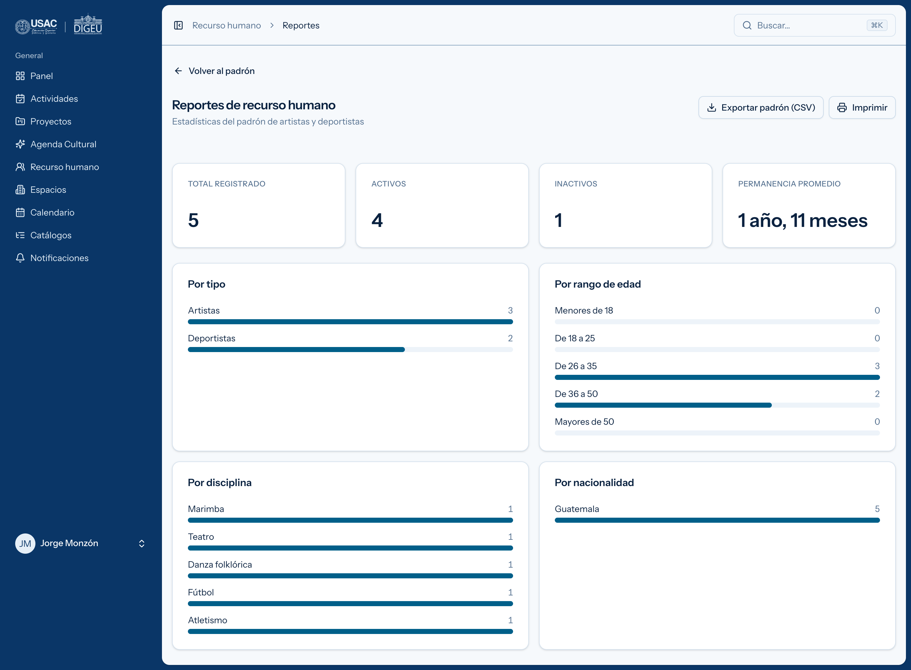

---

## 8. Consulta

Es un acceso **de solo lectura**. Puede ver la información institucional y los
reportes, pero no crear ni modificar nada.

Ve el padrón, el catálogo de espacios, el calendario, los catálogos y la Agenda
Cultural.

> **Para ver también las actividades y los proyectos**, el Administrador debe
> asignarle una unidad a su cuenta. Verá entonces los de esa unidad. Sin unidad
> asignada, esos dos listados aparecen vacíos.

---

## 9. Administrador

Usted configura el sistema. Además de todo lo anterior, tiene tres pantallas
propias.

### 9.1 Usuarios y roles

**Usuarios** en el menú.

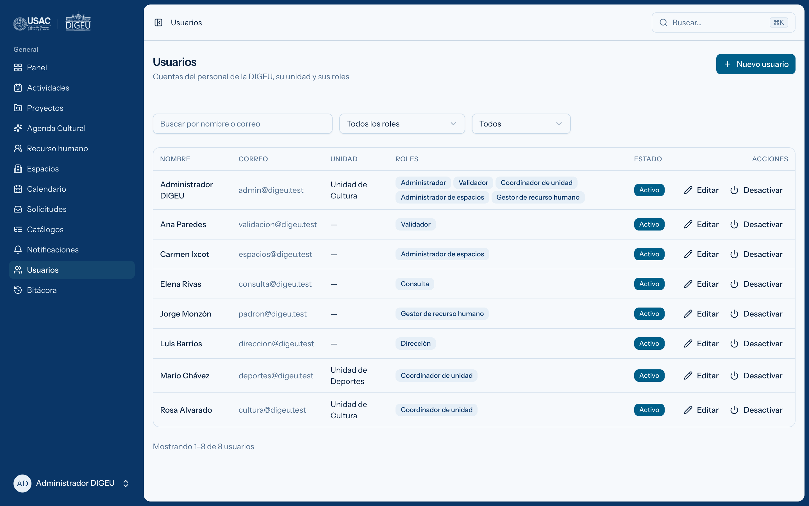

**Para crear una cuenta:** _Nuevo usuario_ → nombre, correo institucional, rol o
roles, y **unidad** si el rol lo necesita.

- Los roles **Coordinador de unidad** necesitan unidad obligatoriamente: sin ella
  no pueden registrar nada.
- Los roles **Administrador, Dirección y Validador** tienen alcance sobre toda la
  DIGEU y no se asocian a una unidad.
- Una cuenta puede tener **más de un rol**; los permisos se suman.

**Para desactivar una cuenta**, use el interruptor de estado. La persona deja de
poder entrar pero su historial se conserva. **No puede desactivar su propia
cuenta**, para que el sistema nunca quede sin administrador.

### 9.2 Catálogos

**Catálogos** en el menú.

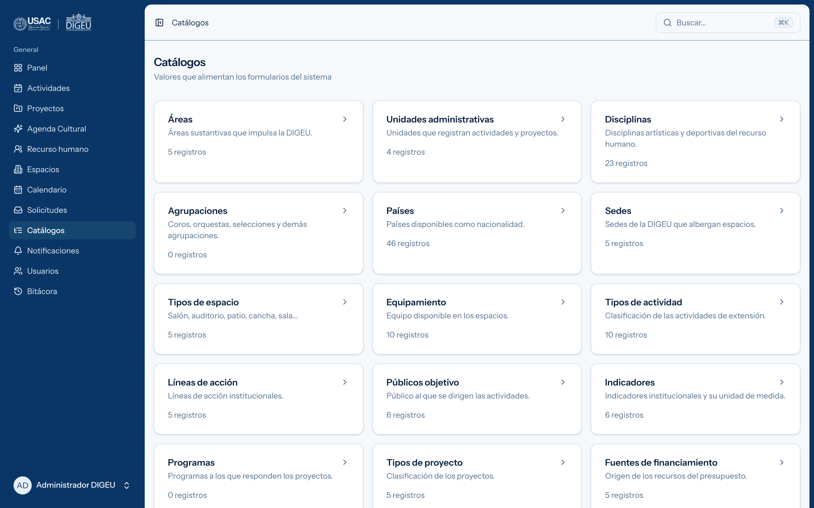

Son las listas que alimentan todos los formularios: áreas, unidades, disciplinas,
agrupaciones, países, sedes, tipos de espacio, equipamiento, tipos de actividad,
líneas de acción, públicos objetivo, indicadores, programas, tipos de proyecto y
fuentes de financiamiento.

> **Desactive en lugar de eliminar.** Un valor desactivado deja de ofrecerse en
> los formularios nuevos, pero los registros que ya lo usan lo conservan. Si
> intenta eliminar un valor que ya está en uso, el sistema lo desactiva en vez
> de borrarlo y se lo avisa, para no dejar registros huérfanos.

### 9.3 Bitácora

**Bitácora** en el menú.

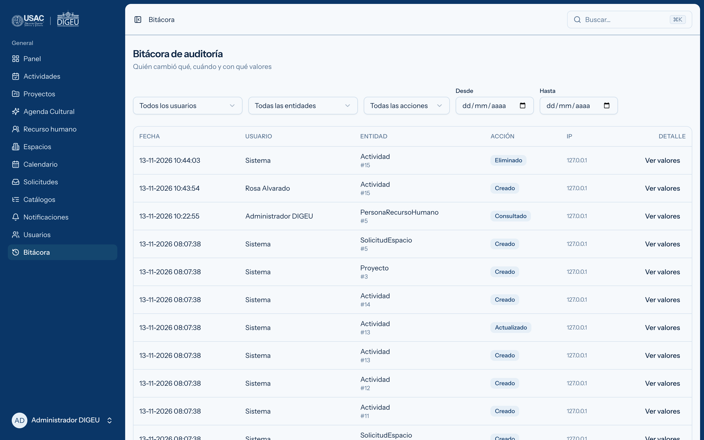

Registro de todo lo que ha pasado en el sistema: quién, qué, cuándo y con qué
valores. Filtre por usuario, por módulo o por fecha. Es solo de lectura y no se
puede borrar.

---

## 10. El sitio público

No requiere cuenta. Es lo que ve cualquier persona en la dirección del sistema.

### La Agenda Cultural

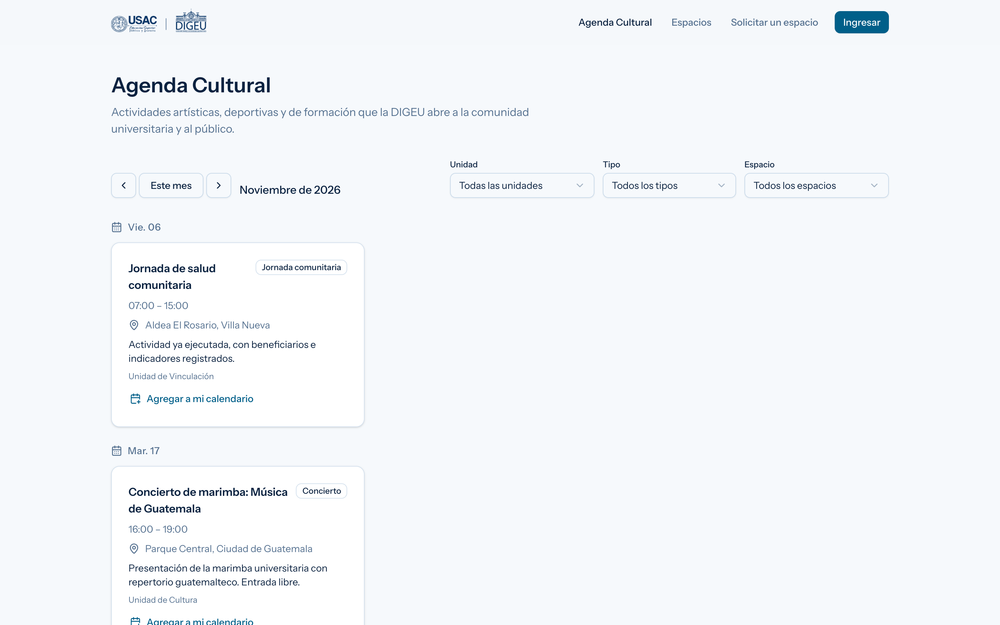

Reúne las actividades que el Validador publicó. Se filtra por mes, unidad, tipo
y espacio. Cada tarjeta ofrece **Agregar a mi calendario**, que descarga el
evento para Google Calendar, Outlook o el calendario del teléfono.

### La página de cada actividad

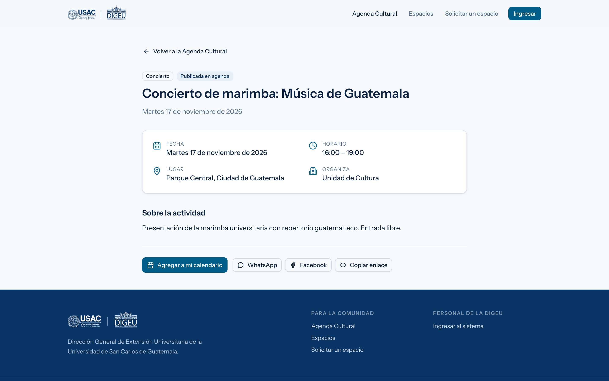

Cada actividad publicada tiene **su propia dirección**, pensada para compartirse:
los botones de **WhatsApp**, **Facebook** y **copiar enlace** están en la página,
y al pegar el enlace aparecen el título, la fecha, el lugar y la imagen
institucional.

### Catálogo de espacios

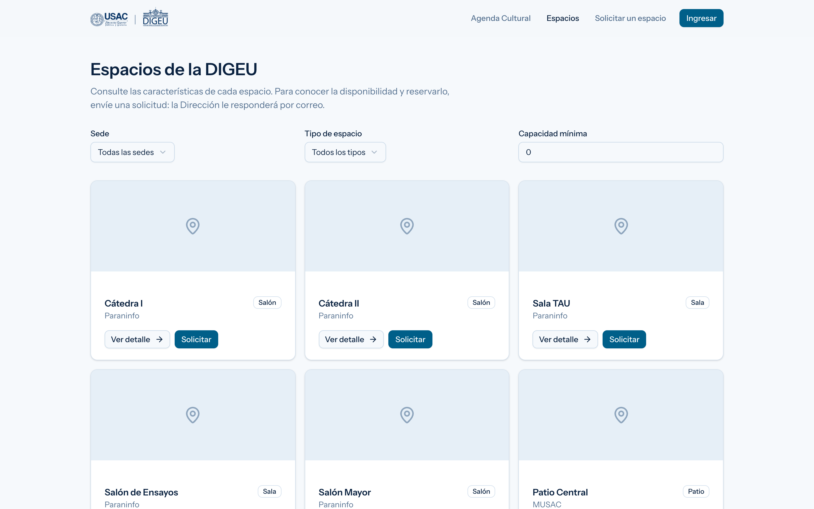

Muestra los espacios activos con sus fotografías, capacidad y equipamiento.

### Solicitar un espacio

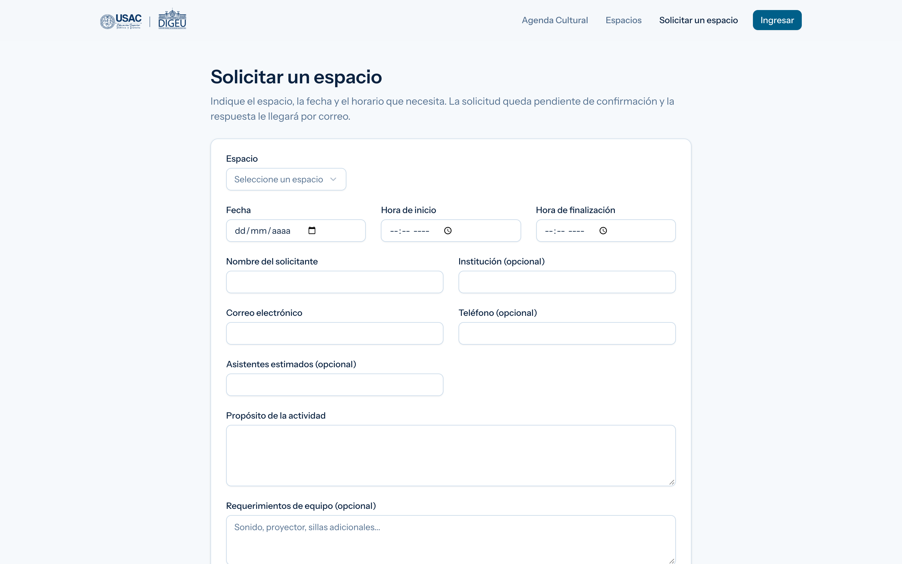

Cualquier persona u organización puede pedir el uso de un espacio. La solicitud
llega a **Solicitudes** del Administrador de espacios, que la resuelve y notifica
al correo que dejó el solicitante.

---

## 11. Anexos

### A. Estados de una actividad

| Estado                  | Significa                               | Quién la mueve       |
| ----------------------- | --------------------------------------- | -------------------- |
| **Borrador**            | En preparación. Solo la ve la unidad.   | Coordinador          |
| **Enviada**             | Esperando revisión.                     | Coordinador la envía |
| **Observada**           | Devuelta con comentarios para corregir. | Validador            |
| **Validada**            | Aprobada, lista para ejecutarse.        | Validador            |
| **Publicada en agenda** | Validada y visible al público.          | Validador            |
| **Reprogramada**        | Cambió de fecha.                        | Coordinador          |
| **En ejecución**        | Ocurriendo.                             | Coordinador          |
| **Cerrada**             | Terminada y con resultados registrados. | Coordinador          |
| **Rechazada**           | Descartada en la revisión.              | Validador            |
| **Cancelada**           | Ya no se hará.                          | Coordinador          |

### B. Estados de un proyecto

| Estado             | Significa                                    |
| ------------------ | -------------------------------------------- |
| **Registrado**     | Creado, falta la formulación.                |
| **En formulación** | Con objetivos, metas y presupuesto en curso. |
| **En revisión**    | Enviado a aprobación.                        |
| **Observado**      | Devuelto con comentarios.                    |
| **Aprobado**       | Listo para iniciar.                          |
| **En ejecución**   | En marcha, con avances.                      |
| **Cerrado**        | Terminado, con informe final.                |
| **Rechazado**      | No aprobado.                                 |
| **Suspendido**     | Detenido temporalmente.                      |
| **Cancelado**      | Terminado antes de tiempo.                   |

### C. Quién puede hacer qué

|                                | Coordinador | Validador | Dirección | Admin. espacios | Gestor RH | Consulta | Administrador |
| ------------------------------ | :---------: | :-------: | :-------: | :-------------: | :-------: | :------: | :-----------: |
| Registrar actividades          |      ●      |           |           |                 |           |          |               |
| Validar y publicar en agenda   |             |     ●     |           |                 |           |          |               |
| Formular proyectos             |      ●      |           |           |                 |           |          |               |
| Aprobar proyectos              |             |     ●     |     ●     |                 |           |          |               |
| Administrar espacios           |             |           |           |        ●        |           |          |               |
| Resolver solicitudes           |             |           |           |        ●        |           |          |               |
| Gestionar el padrón            |             |           |           |                 |     ●     |          |               |
| Ver DPI y pasaporte            |             |           |     ●     |                 |     ●     |          |               |
| Consultar toda la DIGEU        |             |     ●     |     ●     |                 |           |          |       ●       |
| Usuarios, catálogos y bitácora |             |           |           |                 |           |          |       ●       |

El Administrador conserva acceso completo al sistema además de sus pantallas
propias.

### D. Preguntas frecuentes

**No veo el botón que menciona el manual.**
Lo más probable es que su rol no tenga ese permiso, o que la acción no
corresponda al estado actual del registro. Por ejemplo, **Enviar a revisión** no
aparece si la actividad ya fue enviada.

**No veo las actividades de mi unidad.**
Verifique con el Administrador que su cuenta tenga la unidad asignada. Sin
unidad, los listados de actividades y proyectos aparecen vacíos.

**El archivo de carga masiva no sube.**
Debe ser `.xlsx` o `.csv` y pesar menos de 5 MB. Si lo abrió en otro programa,
guárdelo de nuevo en uno de esos dos formatos. Respete el orden de las columnas
de la plantilla.

**La carga masiva me marca una fila que se ve bien.**
Lea el mensaje debajo de la fila: casi siempre es un valor escrito a mano en una
columna que tiene lista desplegable, una fecha en otro formato, o un choque de
horario con una reserva aprobada.

**Me equivoqué al cerrar una actividad.**
Una actividad cerrada ya no se modifica. Avise al Administrador, que puede
revisar lo ocurrido en la bitácora y orientar sobre la corrección.

**Publiqué algo en la agenda por error.**
Entre a la actividad y use **Quitar de la agenda**. Desaparece del sitio público
de inmediato. Si ya se compartió el enlace, quien lo abra verá que la actividad
ya no está disponible.

**¿Cómo saco un PDF?**
Pulse **Imprimir** en el reporte y, en el cuadro de impresión del navegador,
elija **Guardar como PDF** en lugar de una impresora.
